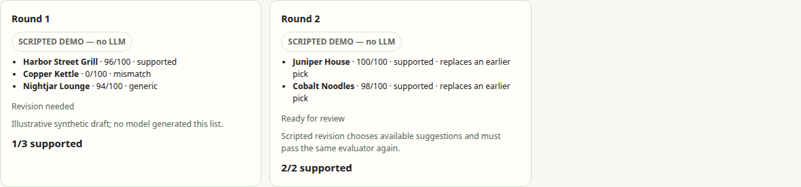
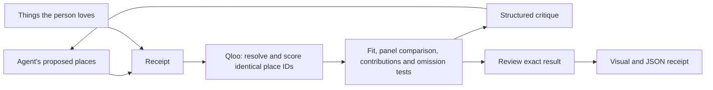

# Receipt

**AI concierges know good places. Receipt checks whether they're good for you.**

[Try the live app](https://receipt.91.99.162.43.sslip.io/) ·
[Judge walkthrough](submission/testing-instructions.md) ·
[Live verification](LIVE_VALIDATION.md)

**Real local study:** the same top-rated shortlist cleared the declared taste
check on 12 of 30 picks across ten curated profiles.
[All outcomes and method](docs/ratings-study.md) · [Connect your own AI via MCP](docs/mcp.md).

Receipt checks an agent's restaurant picks against the person's music, films,
books and shows using Qloo. It returns a critique, tests the changed list against
the same comparison set, and attaches a reviewed receipt to the result.

Built for ticketing, travel and concierge teams that want an inspectable check
between a recommendation agent and its customers.



*Interface preview uses synthetic data. The hosted live example calls Qloo.*

## The live moment

For Kendrick Lamar + Everything Everywhere All at Once near Mission Ballroom,
the generic ratings agent initially selected three highly rated places. Under
the **Distinctive taste** setting, one passed and two had insufficient lift
against our declared reference panel. The agent kept Guard and Grace, replaced
the other two, and all three passed the next audit. No failed draft was planted.

Those two picks cleared the basic fit bar. This demonstrates the selected
panel-relative rule, not that the restaurants are bad or that enjoyment improved.

## Three ways to use it

1. **Audit a list:** enter things the person loves and an agent's proposed places.
   See photos, addresses, taste ranks, Qloo contributions and venue distances.
   Apply suggestions in one click or edit manually; every change gets a new audit.
2. **Watch an agent revise:** proposal → critique → changed list → fresh audit.
   The live generic ratings agent uses real Qloo data and explicit rules, without
   an LLM. It stops immediately if the first draft passes. A separately configured
   model adapter is optional; the synthetic example is labelled.
3. **Test an agent:** import 2–20 captured outputs. Compare variation, failure and
   coverage measures across one shared set, with a stacked bar for every profile.
   Caller-supplied capture provenance is not independently verified.

Passing results can receive browser confirmation and a visual/JSON receipt.
Agents cannot confirm their own results through the agent endpoint.

## How the check works



- A frozen set contains up to 50 taste-independent city references plus eligible
  proposed picks. Every ID needs a finite affinity before ranks are published.
- Category and straight-line radius checks use returned tags and coordinates.
- **Taste rank** is a mid-rank percentile within this set, not an enjoyment probability.
- **Panel lift** is personal percentile minus the mean percentile of three fixed,
  equally weighted profiles: Taylor Swift + Beyoncé; Metallica + Iron Maiden;
  J Balvin + Shakira. Version: contrasting-music-v3-pinned. Same IDs, filters and affinity
  field throughout. All three profiles must have complete scores.
- This curated music panel is **not a representative crowd or popularity estimate**.
  It can overlap the person's tastes. Changing its membership changes the metric.
  Overlap is shown explicitly. The six verified input IDs are pinned to avoid
  ambiguous name searches during a check. Synthetic mode has labelled invented panel scores.
- **Taste match** requires rank ≥ P60. **Distinctive taste** additionally requires
  panel lift ≥ +10 percentile points. These are prototype thresholds.
- The original city-only Taste Lift/generic rate remain unavailable on the live
  service: no-interest responses have no affinity. They are separate fields.
  **Verified-only** still holds when that original baseline is unavailable.
- Qloo contributions show provider-reported influence. Removing one taste shows
  rank sensitivity. Neither establishes why a person will enjoy a place.
- Revisions freeze tastes, policy, city, scope, panel and place IDs. A passing
  re-audit is another check by the same evaluator, not independent validation.

## Run locally

Python 3.12:

```bash
./run.sh setup
cp -n .env.example .env
./run.sh
```

Open http://127.0.0.1:8132/. Put QLOO_API_KEY in the local .env for live evidence.
The key stays server-side. Without it, the app uses clearly labelled synthetic data.

```bash
./run.sh test
./venv/bin/python scripts/check_browser.py
```

The browser check uses an isolated Chrome profile at 1440px and 390px with synthetic
data. GitHub Actions installs a fresh checkout and runs offline tests. Its manual
check_deployment option exercises public HTTPS using actual Qloo calls.

## API integration

Receipt needs a Qloo key on its server. An existing LLM or coding agent can send
proposals to Receipt and revise from its critique using that agent's own model
access; no additional LLM key is required by Receipt. The optional embedded model
adapter below is a separate convenience.

POST /api/agent/audit:

```json
{
  "anchors": ["Kendrick Lamar", "Everything Everywhere All at Once"],
  "candidates": ["Work & Class", "Tavernetta"],
  "city": "Denver, Colorado",
  "policy": "personalized",
  "constraints": {"category": "restaurant", "venue": null},
  "demo": false
}
```

Keep the session cookie. Include revision_of with a prior audit_id to check a
changed list. POST /api/agent/run accepts anchors, city, goal, policy, constraints,
mode (qloo, scripted, live) and max_rounds (1–3).

POST /api/test-suite accepts agent_name, agent_version, prompt_version, a
timezone-aware captured_at timestamp, city and 2–20 profiles. Each profile has
profile_id, anchors, recommendations and optional control_group.
[Import example](examples/captured-output.json): hand-entered inputs, not model captures.

For background work, POST the same body to /api/jobs/audit, /api/jobs/agent or
/api/jobs/batch; poll GET /api/jobs/{job_id}. POST /api/jobs/{job_id}/cancel cancels.
Interactive schemas are available at /docs.

Optional model calls require OPENAI_API_KEY, RECEIPT_LLM_MODEL and
RECEIPT_ALLOW_LLM_CALLS=1. They remain disabled on the hosted demo. The capture
command records real model outputs only after explicit configuration; no real
LLM study is claimed. The qloo agent's free-text task is informational, not interpreted.

## Limits and operations

Hours, bookings, safety, accessibility, road travel time and current prices are
not checked. Venue ratings/price levels are returned metadata, not promises.

One process owns in-memory sessions, jobs and review records. Restart loses state.
Two workers, four admitted runs, 180-second budgets, body/address limits, a private
five-minute cache and per-process provider ceilings bound the demo. Ceilings reset
on restart and are not persistent billing caps. Exhaustion points to the labelled
synthetic sample. Review confirmation does not authenticate reviewer identity.

Native hosting uses systemd/nginx HTTPS through deploy.sh. The separate non-root
Docker recipe is not build-verified. Internal planning and audit documents, keys,
private provider reports and recording assets stay out of Git and deployment.

Built with Python/FastAPI, Pydantic and plain JavaScript on a local FastAPI starter.
Receipt's evaluator, scope checks, agent loop, review flow and report workspace
are the project implementation.

## License

[MIT](LICENSE).
